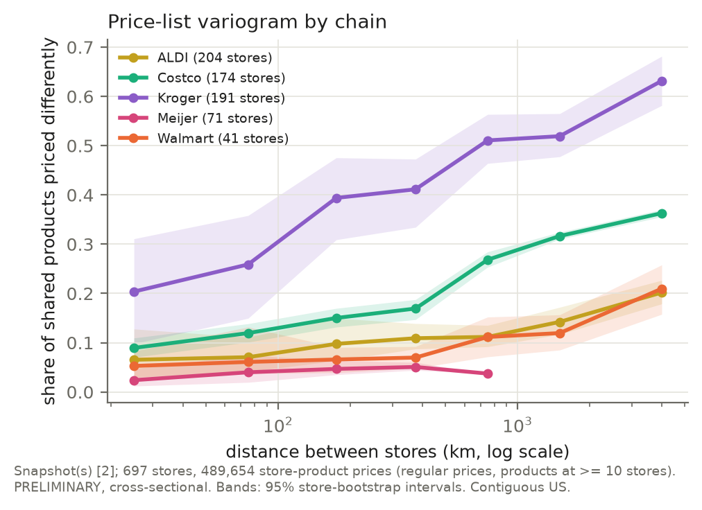
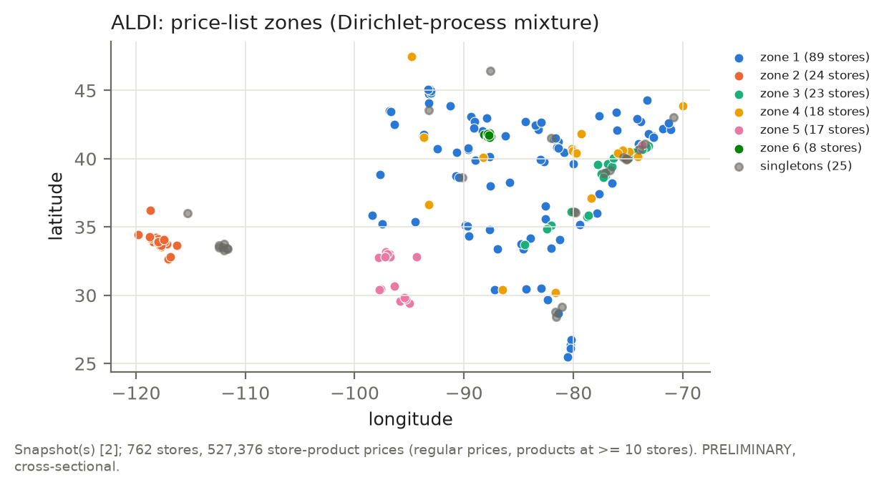
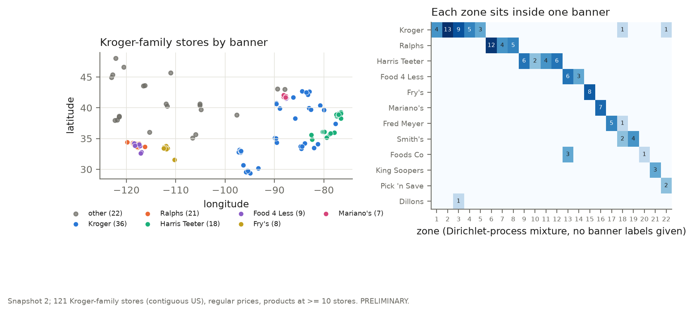
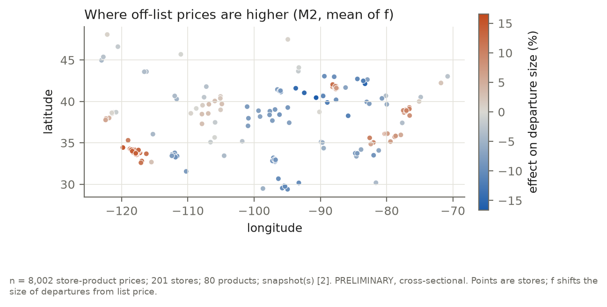
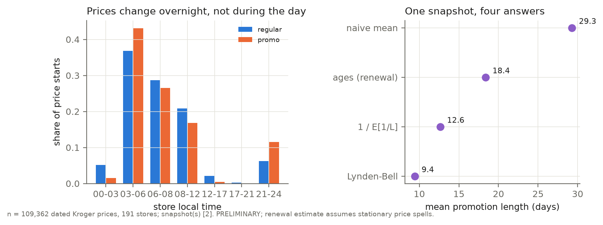

# How Retailers Price Across Space and Time: National Lists, Pricing Zones and Overnight Batches

*Preliminary draft, 2026-10-04. Numbers come from snapshot 2 (one cross-section, Oct 2–4,
2026) and from the retailers' own price timestamps. Every result states its sample size.
Nothing here is causal. A pre-registered event study (§5.4) is in progress. Details of
data checks and methods are in the Appendix. A Kroger banner sample is being added to
snapshot 2 (121 → about 270 stores), so Kroger sample sizes differ between sections. Each
result states its own n, and all Kroger numbers will be rerun once the sample is
complete.*

## Abstract

For identical products, how does a retail chain's price vary across its stores, and when
does it change? We collected store-specific prices for about 60 national-brand items:
- **chains:** six US chains, at up to 250 sampled locations;
- **routes:** retailer websites, Instacart-built storefronts and Kroger's official API.

Most prices sit **exactly** at the chain's list price (91% at ALDI and Walmart, 59% at
Kroger). Dispersion is therefore a point mass plus structured departures, not a continuous
spread. We describe each chain's pricing architecture with:
- a price-list variogram;
- a Dirichlet-process mixture that recovers pricing zones from prices alone;
- a two-part Bayesian spatial model of departures.

The chains differ sharply:
- **ALDI** runs a national list with a few regional zones.
- **Walmart** has a slow geographic gradient.
- **Costco** on Instacart has regional zones about 850 km across.
- **Kroger** has local zones nested inside its banners: 94% banner purity, although the
  model never sees banners.
- **Meijer**, in its Michigan core, has almost one list (97% at list) and one sale calendar.

Kroger's own price timestamps then supply independent evidence that zones are real
decision units:
- **Same day:** stores in the same zone start a price on the same date for 87% of shared
  products (66% across zones).
- **Same minute:** they start it in the same minute for 16% (3% across zones).
- **Timing alone:** clustering stores on timing alone recovers the price zones
  (p = 0.001).
- **Overnight:** prices change in overnight batches, almost never during the day.

Each method was first checked on simulated data with a known answer.

## 1. Question

Under the law of one price, a chain selling an identical product would charge the same
everywhere. DellaVigna and Gentzkow (2019, *QJE*), using Nielsen scanner data, found that
US chains price nearly uniformly across stores despite large differences in local
demographics. We ask a complementary question with public data: **how is a chain's price
list organised across space, and how is it updated over time?**

There are three candidate architectures: one national list, a few discrete zones, or a
continuous gradient. If zones exist, are they the units in which prices are actually
*changed*? The answer differs by chain, and the methods needed to see it are the
contribution.

## 2. Data

**Sources.** Snapshot 2 was collected 2026-10-02 to 2026-10-04 by three routes:
- retailer websites (Walmart, Target, Meijer);
- Instacart storefronts (Costco, and ALDI's own Instacart-built site);
- Kroger's official Public API, which covers its banners (Kroger, Ralphs, Harris Teeter,
  Fry's, Smith's, King Soopers, Mariano's and others).

Instacart prices may include platform pricing, so Instacart chains are reported separately.
Kroger's API also gives every price an **effective timestamp** and a scheduled
**expiration timestamp**. Those two fields are the source of the timing results.

**Stores.**
- 250 locations were drawn by stratified random sampling from Target's 1,893 stores.
  Strata are Census region × RUCA urbanicity.
- For every other chain, the store is the one it assigns to, or has nearest to, each
  location.
- Locations are visited in a balanced-prefix order, so a chain that stops part-way still
  has a stratified, spread-out sample.

**Items.** 58 items:
- 37 national-brand groceries;
- 15 national-brand non-grocery items;
- 6 perishables.

Cross-chain matches use UPCs confirmed from two retailers' catalogues (Appendix A).

**Prices.** The analyses use regular (non-promotional) prices to the cent, and only rows
the retailer itself ties to the requested store.

| Chain | Stores | Store-item pairs | Source; note |
|---|---|---|---|
| ALDI | 205 | 100% | ALDI's Instacart-built site |
| Costco | 175 | 100% | Instacart |
| Kroger family | 122 | 96% | official API; locations without a Kroger store within 15 mi skipped |
| Walmart | 42 | 99% | website; stopped at a captcha after 42 stores |
| Target | 16 | 16 matched items by design | website; short budgeted sessions |
| Meijer | 3 | 100% | website; Midwest only, store locator blocked |

**Do requests reach the intended stores?**
- For every chain, the number of distinct pricing locations the retailer reports equals
  the number of stores requested.
- No two stores more than 1,000 km apart share an identical price list.
- Price-list dissimilarity rises with distance in every chain (Spearman 0.29–0.68).
- One Instacart fallback shop, returned for 37 distant ZIPs, was found and excluded.

Collection was rate-limited: one request at a time per site, at least 5 s apart (9 s for
Kroger). Every raw response is archived, and every failure is logged.

## 3. Methods

**Point mass and departures.** The list price $\ell_j$ is the chain's modal price for
product $j$. We report the share of store prices at $\ell_j$ and the direction and size of
departures, $\log(p_{sj}/\ell_j)$.

**Price-list variogram.** For stores $s, t$, the dissimilarity $\delta_{st}$ is the share of
shared products (at least 20) priced differently. We plot its mean by distance band, with
store-bootstrap bands, and fit an exponential model with nugget, sill and range. When there
is no plateau, we report none.

**Zones.** Each store's price list is coded, product by product, as which of the product's
observed price levels it charges. The model is a Dirichlet-process mixture:
- $z_s \sim \mathrm{CRP}(\alpha)$;
- $c_{sj} \mid z_s = k \sim \mathrm{Cat}(\theta_{kj})$;
- $\theta_{kj} \sim \mathrm{Dir}(\gamma g_j)$, where $g_j$ is the chain-wide level
  frequency (an empirical-Bayes base measure).

Price levels charged by a single store are set aside as local departures. Inference is
collapsed Gibbs (Neal 2000) plus merge–split moves (Dahl 2005), with Escobar–West (1995)
updates for $\alpha$. We run two starts and compare them with the adjusted Rand index
(ARI; Hubert and Arabie 1985).

Robustness checks that do not rely on the model's posterior:
- *split-half replication:* fit two disjoint random halves of the products separately;
- *prior sensitivity:* vary $\gamma$ from 0.5 to 5.

**Two-part spatial model** (M2).
1. Part 1: whether a price is at list, $1\{p_{sj} = \ell_j\} \sim \mathrm{Bernoulli}(\pi_s)$,
   with store effects.
2. Part 2: for prices off list, $\log(p_{sj}/\ell_j) \sim t_\nu(\mu_c + u_s + f(x_s), \sigma)$,
   where $f$ is a Matérn-3/2 Gaussian process (Hilbert-space approximation; Solin and
   Särkkä 2020).

Inference is by NUTS (Hoffman and Gelman 2014; NumPyro). We report the spatial share
$\operatorname{var} f / (\operatorname{var} f + \sigma_u^2)$, PSIS-LOO (Vehtari et al. 2017) against the same
model without $f$, and posterior predictive checks.

**Timing.** Kroger's effective timestamps give, for each store-product, when the current
price began. We test two kinds of synchronisation, using same-banner store pairs only:
- *Co-dating:* the share of shared products whose current price began on the same date,
  or in the same minute, within vs across zones.
- *Timing-only clustering:* stores clustered by co-timing alone, compared with the price
  zones by ARI.

For both, zone labels are permuted *within banner*, so agreement explained by banners
alone is not counted. Promotion lengths use the planned length $L$ = expiration −
effective (§5.3).

**Simulation checks** (Appendix B), all run before reporting real results:
- tail estimators: interval coverage 84–97%;
- zone model: exact recovery of 3–6 zones at a 3% product difference, and one zone when
  there are none;
- two-part model: 13 of 16 parameters inside their 90% intervals;
- promotion-length estimators (§5.3).

## 4. Results: space

| | ALDI (204) | Walmart (41) | Costco (174) | Kroger (121) |
|---|---|---|---|---|
| Prices at list | 91% | 91% | 76% | 59% |
| Departures upward (median) | 19% (−7.9%) | 76% (+4.8%) | 50% (+0.3%) | 66% (+5.7%) |
| $\delta$: stores < 50 km apart → > 2,000 km apart | 6.5% → 20% | 5.3% → 21% | 8.9% → 36% | 25% → 69% |
| Variogram range | no plateau | no plateau | ≈ 850 km | ≈ 240 km |
| Zones | 10; largest 79 stores, 27 states | 5 (not robust) | 18 regional | 21, banner-aligned |
| Nearby stores in the same zone vs permuted | 50% vs 20% | 78% vs 25% | 50% vs 6% | 38% vs 5% |
| Split-half replication (ARI) | 0.52–0.54 | 0.41–0.53 | 0.96 | 0.83–0.98* |

All spatial-coherence p = 0.001. *Kroger's robustness checks were rerun on 160 stores
(banner sample in progress; 25 zones): split-half ARI 0.83–0.98.

*Figure 1. Price-list variogram: share of shared products priced differently, by distance
between stores. Bands are 95% store-bootstrap intervals.*

**Four architectures.**
- **ALDI** runs one national list over most of the country, with regional zones
  (California, the Mid-Atlantic, Texas, Arizona/Nevada) (Figure 2). Its departures are
  mostly markdowns.
- **Walmart** has no identical store lists. Dissimilarity rises slowly with distance, with
  distinct West Coast and Mountain groups. Departures are mostly upward. Its specific zone
  map does not replicate at 41 stores, but the gradient does.
- **Costco on Instacart** forms about 18 regional zones on a scale of about 850 km. They
  replicate almost perfectly: split-half ARI 0.96, and ARI 0.99 across priors.
- **Kroger** is the most local, and its zones follow its banners (Figure 3).
  - Stores less than 100 km apart differ on 11% of shared products within a banner and 77%
    across banners.
  - The zones replicate (split-half ARI 0.83–0.98 at 160 stores).
- **Meijer** (71 stores, mostly Michigan; its locator limited the sample to its core
  region) is the most uniform chain we observe.
  - 97% of prices sit at list.
  - Nearby stores differ on 0.1% of shared products, rising to a plateau of only 4.9%
    (range about 44 km).
  - The 7 zones found are barely more coherent in space than chance (nearby stores share
    a zone 24% of the time vs 21% permuted).
  - They do not replicate: split-half ARI 0.28–0.69, and 6–10 zones depending on
    $\gamma$.

*Figure 2. ALDI's price-list zones (Dirichlet-process mixture): one national list plus
regional zones.*

*Figure 3. Kroger-family stores by banner (left), and banner × zone counts (right). The zone
model never sees banners, yet almost every zone falls inside one banner.*

**Departures and extremes** (M2, Figure 4). Kroger (160 stores, partway through the
banner sample) and Walmart (41), contiguous US: 8,002 prices, 70% at list.
- **Convergence:** 4 × 2,000 draws; R-hat ≤ 1.006, minimum bulk ESS 877, no divergences.
- **Spatial share:**
  - Kroger 0.996 (90% interval 0.985–1.000). Kroger's store-level departure sizes are
    almost entirely regional; the field cannot separate banner territories from a smooth
    surface.
  - Walmart 0.51 (0.35–0.68).
  - Length-scale about 92 km (66–122 km).
- **Size:** departures average +3.0% at Kroger (2.5–3.4%) and about 0 at Walmart (−0.1%).
  Stores' tendency to depart clusters in space (Moran's I 0.43 and 2.08, p = 0.0002).
- **Fit:**
  - PSIS-LOO does not separate the spatial model from the model without $f$ (difference
    30 ± 22 elpd, favouring the simpler model).
  - Posterior predictive checks reproduce the share at list, but the extreme departures
    are heavier than the model's $t_{\nu \approx 2.2}$ (99th percentile 0.34 observed vs 0.30
    replicated).
- **Extremes:** the extreme upper tail is mostly geographic. A Honolulu Walmart charges
  \$6.28 for milk against a chain median of \$2.97. Without Hawaii and Alaska, Walmart's
  generalised-Pareto shape is about 0 ($\hat\xi = -0.04$, 95% CI −0.40 to 0.14): no
  power-law tail.

*Figure 4. Posterior mean of the spatial field $f$ in the two-part model: where off-list
prices are higher.*

**What predicts price levels? Not demographics.** We tried about 130 neighbourhood,
urbanicity and competition predictors, with state-blocked cross-validation. Out-of-sample
R² with the best shrinkage model:
- ALDI: about 0 (184 stores);
- Kroger: 0.11 (108 stores);
- Costco: 0.19 (163 stores; horseshoe).

The only clear Kroger coefficient is North Carolina (+2.3%), which is in effect the Harris
Teeter banner. Price levels show no urban–rural difference in any chain. Location matters
through the retailer's zone design, not local demographics, consistent with DellaVigna and
Gentzkow.

**Across chains.** On identical UPCs, medians vs Walmart:
- Target +0.5% (10 UPCs, 16 stores);
- Meijer +5.6% (17 UPCs, 3 stores);
- Kroger +9.8% (15 UPCs, 121 stores; IQR +6.2 to +18.0).

One chain is cheapest on nearly every item, so splitting a 12-item basket across 2–3
nearby stores saves a median of **0.05%**. The test covers 88 locations, and the exact
integer program and the greedy heuristic agree everywhere. Cross-chain gaps are level
differences, so the violations of the law of one price leave almost no basket arbitrage.

## 5. Results: time (Kroger, n = 68,856 dated prices, 121 stores)

**5.1 When prices change.** Prices start on Wednesdays, the start of Kroger's ad week: 89%
of promotions and 54% of regular prices. 80% of promotions end on a Tuesday night, and 91%
run a whole number of weeks. By store-local time:
- 64% of price starts fall 03:00–08:00, and 18% fall 08:00–12:00;
- **2.5% of regular prices and 0.3% of promotions** start between noon and 21:00.

Prices change in overnight and morning batches. We see no sign of the demand-driven
("surge") intraday repricing feared with electronic shelf labels (Figure 5a).

**5.2 Zones change prices together.** For same-banner store pairs (1,118), the share of
shared products whose current price began at the same moment:

| Same start | Within zone | Across zones | Permutation p |
|---|---|---|---|
| date | 0.87 | 0.66 | 0.0003 |
| minute | 0.16 | 0.03 | 0.0003 |

Zone labels were permuted within banner, 2,999 times. Three checks:
- **Not a by-product of shared prices.** Zones were estimated from price *levels* only, so
  timestamps are independent evidence. Holding the price fixed, same-zone pairs still
  share start dates more often:
  - same price: 0.88 vs 0.74;
  - different price: 0.59 vs 0.49.
- **Timing alone recovers the zones.** Clustering stores only by how often their prices
  begin in the same minute matches the price zones at ARI 0.58. The within-banner
  permutation baseline is 0.43 (p = 0.001).
- **Not a by-product of distance.** Same-zone stores are closer together, so we fit a
  hierarchical binomial model for each same-banner pair (191 stores, 1,535 pairs):
  co-timed products out of shared products, with a same-zone indicator, log distance,
  store effects (pairs sharing a store are dependent) and pair-level overdispersion.
  - Holding distance and store effects fixed, being in the same zone multiplies the odds
    of a shared start date by 1.59 (90% interval 1.50–1.69) and of a shared start minute
    by 1.75 (1.38–2.21).
  - NUTS: R-hat ≤ 1.006, no divergences.
- **Conclusion.** Prices and timestamps are two independent views, and they identify the
  same pricing units.
- **Meijer, by contrast, runs one sale calendar** (71 stores; Meijer reports when each
  store's sale price ends).
  - For a given product, 99.7% of store pairs end the sale on the same date. Zones add
    nothing (0.1 percentage points; 2,485 pairs).
  - 83% of sales end on a Tuesday, and 6,953 store-products end on Oct 6–7: the same night
    as Kroger's mass expiry (§5.4). Both chains turn over their ad weeks together.

**5.3 How long do promotions last? One snapshot, four answers.** A snapshot sees only
promotions still running, so long promotions are over-represented (the inspection
paradox). Each correction relies on a different invariance:

| Estimator | Mean (days) | Assumes |
|---|---|---|
| Naive mean of planned lengths | 28.5 | nothing (length-biased) |
| Renewal theory from ages, $\mu = 1/f_A(0)$ (Cox 1962) | 18.3 | stationarity |
| Length-bias correction, $1/\mathbb{E}[1/L]$ | 12.7 (12.4–12.9) | equal weekly cohorts |
| Lynden-Bell (1971) product-limit, left-truncated at age (Woodroofe 1985) | 9.4 (9.1–9.9) | same length mix each week |

Intervals are 95% store bootstrap.

A simulation (200 replications) shows the three corrections agree under stationarity. If
one week's cohort has a different length mix, they split in exactly the observed order:
ages-only is biased up (+2.8 days on a 15.5-day truth), Lynden-Bell down (−0.7), and the
harmonic mean stays close. The data agree with that explanation:
- age / planned length, which is uniform under stationarity, has mean 0.56, and 0.71 for
  2-week promotions;
- the most recent weekly cohort is smaller than the one before.

One snapshot cannot separate cohort size from cohort mix. The event below sees a whole
cohort when it starts.

*Figure 5. (a) Store-local time at which Kroger prices take effect. (b) Mean promotion
length from one snapshot under four estimators.*

**5.4 A pre-registered event (in progress).** 9,326 snapshot-2 promotions at 113 stores are
scheduled to expire at one instant nationwide: Tuesday Oct 6, 23:59 Eastern. Before any
event data existed, we committed the following (`docs/PREREGISTRATION_EVENT.md`, commit
af68714):
- **seven predictions:**
  - the expiry is enforced;
  - the expiration date predicts which prices change;
  - more prices change on the event night than on a control night;
  - the old prices expire at the instant;
  - new prices arrive in two batches;
  - zones switch together;
  - prices settle afterwards;
- the frozen zones, the 60 panel stores, and the analysis code, tested on synthetic data.

Panel passes run Monday (control) to Thursday, with probes around midnight. The control
pass was rerun on Monday evening after a scripting failure (Addendum 3; no prediction
changed). Meijer's sale prices end the same night, so a Meijer arm (15 stores; control,
before and after passes) was pre-registered before its data (Addendum 4: M1–M4, with the
same thresholds plus "one new price across stores").

[result: Module H predictions table (`tables/module_h_predictions.md`) and Figure 6.]

**5.5 Walmart repeat visits (in progress).** Walmart publishes no price dates, so we
revisit 10 stores (17 confirmed items) three times a day from Monday to Thursday. Each
visit reaches the same 6–7 stores before Walmart's per-session limit (about 105 requests).
- **First result** (4 stores, morning vs afternoon): 0 of 707 store-products changed
  price within the day, and off-list prices persisted.
- **Still to measure:** overnight change rates, persistence of local departures (a
  two-state Markov chain), and delivery-slot lead times, which track time of day rather
  than store.

[result: Module I tables.]

## 6. Limitations

- **Mostly cross-sectional.** Nothing is causal. Timing comes from Kroger's reported
  timestamps; the event panel checks them against observed changes. An effective date may
  reset when an unchanged price is re-entered.
- **Website prices,** not shelf audits. Costco's local structure may partly be
  Instacart's.
- **Partial chains.** Walmart (41 stores), Target (16) and Meijer (3) limited automated
  access at low volume. They are spread across strata by design, but small.
- **Sampling.** Locations come from Target's footprint, which over-represents urban areas
  for the other chains. Items are hand-picked national brands.
- **Zone model.** Products are treated as independent within a zone, so posterior
  certainty about the number of zones is overstated. The replication checks address this.
- **Locations** are mostly ZIP centroids. Timing results are for Kroger only.

## 7. Reproducibility

The raw archive rebuilds the database (`python -m collectors.reparse`), and
`python run_all.py` regenerates every table and figure. Simulation checks live in
`simulation/`, decisions are logged in `docs/DECISIONS.md`, and the event
pre-registration is in `docs/PREREGISTRATION_EVENT.md`.

## References

- Cox, D. R. (1962). *Renewal Theory*. Methuen.
- Dahl, D. B. (2005). Sequentially-allocated merge-split sampler for conjugate and
  nonconjugate Dirichlet process mixture models. Technical report, Texas A&M University.
- DellaVigna, S., and Gentzkow, M. (2019). Uniform pricing in U.S. retail chains.
  *Quarterly Journal of Economics* 134(4), 2011–2084.
- Edelsbrunner, H., and Harer, J. (2010). *Computational Topology: An Introduction*.
  American Mathematical Society.
- Escobar, M. D., and West, M. (1995). Bayesian density estimation and inference using
  mixtures. *Journal of the American Statistical Association* 90(430), 577–588.
- Hill, B. M. (1975). A simple general approach to inference about the tail of a
  distribution. *Annals of Statistics* 3(5), 1163–1174.
- Hoffman, M. D., and Gelman, A. (2014). The No-U-Turn sampler. *Journal of Machine
  Learning Research* 15, 1593–1623.
- Hubert, L., and Arabie, P. (1985). Comparing partitions. *Journal of Classification* 2,
  193–218.
- Lynden-Bell, D. (1971). A method of allowing for known observational selection in small
  samples applied to 3CR quasars. *Monthly Notices of the Royal Astronomical Society* 155,
  95–118.
- Neal, R. M. (2000). Markov chain sampling methods for Dirichlet process mixture models.
  *Journal of Computational and Graphical Statistics* 9(2), 249–265.
- Pickands, J. (1975). Statistical inference using extreme order statistics. *Annals of
  Statistics* 3(1), 119–131.
- Piironen, J., and Vehtari, A. (2017). Sparsity information and regularization in the
  horseshoe and other shrinkage priors. *Electronic Journal of Statistics* 11(2),
  5018–5051.
- Solin, A., and Särkkä, S. (2020). Hilbert space methods for reduced-rank Gaussian process
  regression. *Statistics and Computing* 30, 419–446.
- Vehtari, A., Gelman, A., and Gabry, J. (2017). Practical Bayesian model evaluation using
  leave-one-out cross-validation and WAIC. *Statistics and Computing* 27, 1413–1432.
- Woodroofe, M. (1985). Estimating a distribution function with truncated data. *Annals of
  Statistics* 13(1), 163–177.

---

## Appendix A. Data checks

**Item matching.**
- The canonical UPC comes from Kroger and Meijer, which report a UPC for every product.
  They agree on 22 items, and 37 of 52 cross-chain items have a canonical UPC.
- Walmart products are confirmed by the UPC on their product page (17 items).
- Target products are matched by name and size (21 items; weaker evidence).
- Variant, multipack and store-brand candidates are rejected by rule, and seven fields
  were vetoed by hand.

**Store attribution.** Distinct pricing locations equal stores requested: ALDI 205/205,
Costco 175/175, Kroger 108/108 at the check, Walmart 42/42.

**Locations.** For Target, Walmart, Kroger and Meijer, a store's location comes from the
retailer. Instacart returns no address, so the anchor ZIP stands in. Costco anchors lie a
median of 7 km from a real Costco (OpenStreetMap).

**Fallback shop.** One ALDI location was returned for 37 ZIPs from Washington to Hawaii, all
without a nearby ALDI. It was excluded by a documented rule (more than 300 km between
anchors).

**Promotions.** A price is a promotion when the retailer reports a regular price above
the current one. Multi-buy offers are recorded but not treated as prices.

**Session policy.** A fresh session refused on its first request counts as a block and
triggers a pause of 3 h, then longer on repeats. A session refused after it has worked is
replaced at most twice per run.

Target refused sessions after about 50 requests (three tests: 50, 51, 51). A fresh session
completed every run, and no test triggered a counted block.

## Appendix B. Methods detail and validation

**Variogram.** $\gamma(h) = \text{nugget} + (\text{sill} - \text{nugget})(1 - e^{-h/r})$.
Pairs sharing a store are dependent, so bands come from a store bootstrap.

**Zones.**
- H0 persistent homology (Edelsbrunner and Harer 2010) of the single-linkage filtration of $\delta$ gives a
  model-free view of the zones.
- In the Dirichlet-process model, zones with identical estimated lists are merged,
  because they are not identifiable.
- Spatial coherence compares how often stores < 250 km apart share a zone against
  permuted labels.

**Prior sensitivity of the zones.**
- Kroger (160 stores): $\gamma = 0.5$ vs 1 gives ARI 0.92; $\gamma = 5$ merges zones
  (25 → 14).
- ALDI: 7–11 zones across $\gamma$. With 91% of prices at list and 0.6% unique to one
  store, each store carries little information.
- Walmart: 4–6 zones.

**Two-part model history.** Two simpler models failed to converge on real data:
- a single Student-$t$ residual (R-hat about 3);
- a latent mixture that label-switched.

Those failures revealed the point mass. The reference normal model (M0) still does not
converge. With only 2 UPCs shared between chains, the chain effect is omitted.

**Tails.** Hill (1975) ($k = 5\%$, with stable-$k$ and $k = 10\%$ sensitivity) and
generalised-Pareto (Pickands 1975) estimates with store-cluster bootstrap intervals. At $n = 250$, the
$k = 5\%$ Hill interval covered the true value 84–97% of the time.

**Predictors.** We compare OLS, lasso, elastic net and a regularised horseshoe (Piironen and Vehtari 2017). Low-rank
factor structure in the store × product deviation matrix is supported for ALDI (rank 4),
Costco (3) and Kroger (8), but not for Walmart (cross-validation picks rank 0).

**Timing details.**
- Regular-price spells have a renewal-estimated mean of about 32 days. The age tail has
  Hill $\hat\alpha \approx 2.3$ (2.2–2.5).
- Kroger reports stock levels for 81% of store-products: 61% HIGH, 12% LOW, 8% out of
  stock. These shares are the same for promotions and regular prices.
- Promotion-length simulation: `simulation/validate_promo_lengths.py` (stationary,
  varying cohort sizes, varying length mix).
