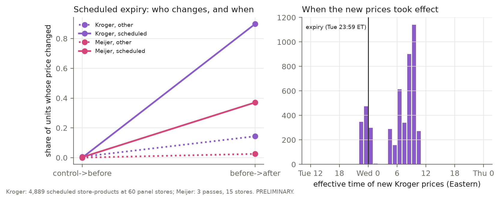

# How Retailers Price Across Space and Time: National Lists, Pricing Zones and Overnight Batches

*Preliminary draft, 2026-10-07. One cross-section (Oct 2–5, 2026), the retailers' own price
timestamps, and event panels (Oct 5–8). Every result states its sample size; nothing here
is causal. Data checks and method details are in the Appendix.*

## Abstract

How does a retail chain's price for an identical product vary across its stores, and when
does it change? We collected store-specific prices for 58 national-brand items at six US
chains (up to 250 sampled locations; retailer websites, Instacart-built storefronts and
Kroger's official API).

Most prices sit **exactly** at the chain's list price (91% at ALDI and Walmart, 65% at
Kroger), so dispersion is a point mass plus structured departures. A price-list variogram,
a Dirichlet-process mixture that finds pricing zones from prices alone, and a two-part
Bayesian spatial model reveal four architectures:
- ALDI: a national list with regional zones;
- Walmart: a slow gradient;
- Costco on Instacart: regional zones;
- Kroger: local zones nested in its operating divisions (95% purity), which the model
  never sees.

Kroger's price timestamps independently confirm the zones: same-zone stores start a price
record in the same minute 4× as often as other stores, beyond distance. Each zone is
updated as an overnight batch that walks its store list in store-number order.

A pre-registered event study followed a nationwide promotion expiry (60 Kroger stores,
34,177 store-products). Nine of ten predictions held: the expiry was enforced within 16
minutes, and the event night had 46× the control night's change rate. One failed: zones
did not significantly share the new effective minute (p = 0.06). Walmart, revisited 9
times, changed 3 prices in 11,725 transitions. Every method was first checked on simulated
data.

## 1. Question

Under the law of one price, a chain selling an identical product would charge the same
everywhere. DellaVigna and Gentzkow (2019, *QJE*), using Nielsen scanner data, found that
US chains price nearly uniformly across stores despite large differences in local
demographics. We ask a complementary question with public data: **how is a chain's price
list organised across space, and how is it updated over time?**

There are three candidate architectures: one national list, a few discrete zones, or a
continuous gradient. If zones exist, are they the units in which prices are actually
*changed*? The answer differs by chain, and the methods needed to see it are the
contribution.

## 2. Data

**Cross-section** (snapshot 2, Oct 2–5, 2026). Store-specific prices for 58 national-brand
items, collected three ways:
- retailer websites (Walmart, Target, Meijer);
- Instacart storefronts (Costco, and ALDI's own Instacart-built site), which may include
  platform pricing and are reported separately;
- Kroger's official API, covering its banners (Kroger, Ralphs, Harris Teeter, Fry's,
  King Soopers, Dillons and others).

Cross-chain matches use UPCs confirmed from two retailers' catalogues (Appendix A). The core sample is 250
locations drawn from Target's 1,893 stores, stratified by Census region × RUCA urbanicity.
Each other chain contributes the store it assigns to, or has nearest to, each location.
Kroger and Meijer were then extended with samples designed for their footprints.

We use regular prices to the cent, and only rows the retailer ties to the requested store.

| Chain | Stores | Store-item coverage | Note |
|---|---|---|---|
| ALDI | 205 | 100% | Instacart-built site |
| Costco | 175 | 100% | Instacart |
| Kroger family | 192 | 96% | official API; 16 banners, 20 divisions |
| Meijer | 83 | 100% | Michigan core (its locator blocks automated use) |
| Walmart | 84 | 99% | all 250 anchors (extended Oct 6–7) |
| Target | 35 | 16 matched items | short budgeted sessions |

**Timestamps and panels.** Kroger's API gives every price an *effective* and a scheduled
*expiration* timestamp; Meijer gives a sale's end date. The pre-registered event panels
(Kroger, 60 stores × 7 passes; Meijer, 15 stores × 3) and a Walmart repeat-visit panel (10
stores × 3 visits a day) cover Oct 5–8.

Requests reach the intended stores (Appendix A). Collection is rate-limited (one request
at a time per site), every raw response is archived, and every failure is logged.

## 3. Methods

**Point mass and variogram.** The list price $\ell_j$ is the chain's modal price for product
$j$; departures are $\log(p_{sj}/\ell_j)$. For a pair of stores, the dissimilarity
$\delta_{st}$ is the share of shared products (at least 20) priced differently. Its mean by
distance band, with store-bootstrap bands, gives a price-list variogram, fitted with an
exponential nugget–sill–range model. When there is no plateau, we report none.

**Zones.** Each store's list is coded as which observed price level it charges for each
product, under a Dirichlet-process mixture:
- $z_s \sim \mathrm{CRP}(\alpha)$;
- $c_{sj} \mid z_s = k \sim \mathrm{Cat}(\theta_{kj})$;
- $\theta_{kj} \sim \mathrm{Dir}(\gamma g_j)$, where $g_j$ is the chain-wide level frequency (an
  empirical-Bayes base measure).

Levels charged by a single store are set aside. Inference: collapsed Gibbs (Neal 2000),
merge–split moves (Dahl 2005) and Escobar–West (1995) updates for $\alpha$, from two starts
compared by adjusted Rand index (ARI; Hubert and Arabie 1985). Zones are judged by
**split-half replication** (disjoint halves of the products) and **prior sensitivity**
($\gamma$ from 0.5 to 5), not by the posterior alone.

**Two-part spatial model.**
- Whether a price is at list: Bernoulli with store effects.
- Off-list departures: $t_\nu(\mu_c + u_s + f(x_s), \sigma)$, with $f$ a Matérn-3/2 Gaussian
  process (Hilbert-space approximation; Solin and Särkkä 2020).
- NUTS (Hoffman and Gelman 2014); spatial share $\operatorname{var} f / (\operatorname{var} f + \sigma_u^2)$; PSIS-LOO
  (Vehtari et al. 2017); posterior predictive checks.

**Timing.** For each store-product, the effective timestamp gives when the current price
record began.
- *Co-timing:* we compare same-zone and different-zone store pairs (same banner) on how
  many shared products began on the same day or minute. Zone labels are permuted within
  banner, so banners alone earn no credit.
- *Dyadic binomial model* (adds distance and store effects), *timing-only clustering*
  (compared with the price zones by ARI), and the pre-registered *event study* (§5.4).

**Simulation checks** (Appendix B), all run before the real results: the zone model
recovers zones exactly at a 3% product difference and finds one zone when there are none;
the dyadic model is unbiased and removes the spurious zone effect that distance alone
creates; tail-estimator coverage is 84–97%.

## 4. Results: space

| | ALDI (204) | Walmart (83) | Costco (174) | Kroger (191) |
|---|---|---|---|---|
| Prices at list | 91% | 92% | 76% | 65% |
| Departures upward (median) | 19% (−7.9%) | 75% (+4.9%) | 50% (+0.3%) | 66% (+4.5%) |
| $\delta$: stores < 50 km apart → > 2,000 km apart | 6.5% → 20% | 5.0% → 17% | 8.9% → 36% | 20% → 63% |
| Variogram range | no plateau | no plateau | ≈ 850 km | no plateau* |
| Zones | 10; largest 79 stores, 27 states | 12 (not robust) | 18 regional | 28, division-aligned |
| Nearby stores in the same zone vs permuted | 50% vs 20% | 59% vs 10% | 50% vs 6% | 48% vs 5% |
| Split-half replication (ARI) | 0.52–0.54 | 0.09–0.41 | 0.96 | 0.90–0.98* |

All spatial-coherence p = 0.001. *Kroger's variogram had a plateau at about 240 km on its
first 121 stores; with distant divisions added it keeps rising (local zones within a
nationwide gradient). Prior sensitivity at 191 stores: γ = 0.5 vs 1, ARI 0.95.

*Figure 1. Price-list variogram: share of shared products priced differently, by distance
between stores. Bands are 95% store-bootstrap intervals.*

**Four architectures.**
- **ALDI** runs one national list over most of the country, with regional zones
  (California, the Mid-Atlantic, Texas, Arizona/Nevada) (Figure 2). Its departures are
  mostly markdowns.
- **Walmart** has no identical store lists; dissimilarity rises steadily with distance.
  Doubling the sample to 83 stores did **not** make zones appear (split-half ARI
  0.09–0.41): Walmart prices on a gradient.
- **Costco on Instacart** forms about 18 regional zones about 850 km across, which
  replicate almost perfectly (ARI 0.96; 0.99 across priors).
- **Kroger** is the most local (Figure 3). Stores within 100 km differ on 8% of shared
  products within a banner and 72% across banners.

  **They follow Kroger's operating divisions even more closely than its banners.** The
  location id starts with a 3-digit division number. At 191 stores (16 banners, 20
  divisions, 28 zones):

  | Zones compared with | Purity | ARI | Zones inside one group |
  |---|---|---|---|
  | division | 95% | 0.71 | 89% |
  | banner | 89% | 0.51 | 82% |

  The "Kroger" banner spans 9 divisions and is split along them, while banners that share
  a division share zones (Food 4 Less and Foods Co; Dillons, Baker's and Gerbes). Prices
  alone recover the organisational pricing units.
- **Meijer** (71 stores, Michigan core) is nearly uniform: 97% of prices at list, nearby
  stores differing on 0.1% of products, and no replicable zones (ARI 0.28–0.69).

*Figure 2. ALDI's price-list zones (Dirichlet-process mixture): one national list plus
regional zones.*

*Figure 3. Kroger-family stores by banner (left), and banner × zone counts (right). The zone
model never sees banners, yet most zones fall inside one banner (and more inside one
division).*

**Departures and extremes** (M2, Figure 4). The model is fitted to Kroger (191 stores),
Meijer (71), Walmart (83) and Target (39): 15,317 prices, 80% at list. It converges
(4 × 2,000 draws, R-hat ≤ 1.007, bulk ESS ≥ 430, no divergences).
- **Spatial share of store-level departure size:** Kroger 0.88 (90% interval 0.83–0.92);
  Target 0.46 (0.33–0.61); Walmart 0.39 (0.27–0.50); Meijer 0.12 (0.05–0.20). Kroger's
  departures are regional, while Meijer's are store-specific. Length-scale about 150 km.
- **Fit:** PSIS-LOO favours the spatial model by 80 ± 13 elpd. Departures are very
  heavy-tailed ($t_{\nu \approx 1.5}$).
- **Extremes:** the upper tail is mostly geographic. A Honolulu Walmart charges \$6.28
  for milk against a chain median of \$2.97. Without Hawaii and Alaska, Walmart's
  generalised-Pareto shape is about 0 ($\hat\xi = 0.03$, 95% CI −0.22 to 0.19).

*Figure 4. Posterior mean of the spatial field $f$ in the two-part model: where off-list
prices are higher.*

**Not demographics.** About 130 neighbourhood, urbanicity and competition predictors, with
lasso, elastic net and a horseshoe under state-blocked cross-validation, give
out-of-sample R² of about 0 (ALDI, 184 stores), 0.39 (Kroger, 191) and 0.19 (Costco, 163).
Kroger's higher figure is probably the zone design showing through: its divisions
follow geography that demographics proxy. Elsewhere location matters through the zone
design, not local demographics, consistent with DellaVigna and Gentzkow.

**Across chains,** on identical UPCs, medians vs Walmart are Target +0.5% (10 UPCs, 16
stores), Meijer +5.6% (17, 71) and Kroger +9.7% (16, 191). One chain is cheapest on nearly
every item, so splitting a 12-item basket across 2–3 nearby stores saves a median of
**0.05%** (88 locations; the integer program and a greedy heuristic agree): violations of
the law of one price leave almost no basket arbitrage.

## 5. Results: time (Kroger, n = 109,362 dated price records, 191 stores)

*What a timestamp measures.* Kroger's effective timestamp marks when the current price
**record** began. Over 1–3 days, 7.8% of regular-price records (0.9% of promotions) got a
new timestamp at an **identical** price, in store-level batches. So co-timing describes
the system's **update batches**; the event study (§5.4) observes actual price changes.

**5.1 When price records start.** 89% of promotions and 54% of regular prices start on a
Wednesday, the start of Kroger's ad week, and 90% of promotions run a whole number of
weeks. By store-local time, 66% of starts fall 03:00–08:00; **only 2.3% of regular prices
and 0.4% of promotions** start between noon and 21:00 (Figure 5a). There is no sign of
intraday ("surge") repricing.

**5.2 Zones change prices together.** Zones were estimated from price *levels* only, so
timestamps are an independent test of whether they are real units. The table uses
same-banner store pairs (1,535); p-values come from permuting zone labels within banner.

| Statistic | Same zone | Different zone | Evidence |
|---|---|---|---|
| Share of shared products whose current price record began the same **day** | 0.90 | 0.68 | p = 0.0003 |
| ... the same **minute** | 0.25 | 0.06 | p = 0.0003 |
| Same day, products at the same price / at different prices | 0.91 / 0.72 | 0.76 / 0.51 | holds at fixed price |
| Promotions only (real price changes; rarely reset): same day / same minute | 0.98 / 0.17 | 0.92 / 0.04 | p = 0.001 each |
| Hierarchical binomial model, odds ratio for same zone, day / minute | 1.59 / 1.75 | 1 | 90% intervals 1.50–1.69 and 1.38–2.21 |
| Stores clustered by co-timing alone, agreement with price zones (ARI) | 0.70 | 0.60 (permuted) | p = 0.001 |

The model controls for log distance, store effects and pair-level overdispersion (NUTS:
R-hat ≤ 1.006, no divergences), so **prices and timestamps identify the same pricing
units.** Two exploratory findings: within a division (1,354 pairs) the same-minute share
is 0.28 within zone vs 0.16 across (p = 0.0005), and each batch **walks the store list in
store-number order** (Kendall's W median 0.62 vs about 0.003 under the null in all 24
zones tested; Spearman 0.92 on average). Meijer, by contrast, runs one sale calendar
(71 stores): 99.7% of store pairs end a sale on the same date.

**5.3 How long do promotions last? One snapshot, four answers.** A snapshot over-represents long
promotions (the inspection paradox). Corrections resting on different invariances disagree (Figure 5b): naive mean 29.3 days;
renewal theory from ages 18.4; length-bias correction $1/\mathbb{E}[1/L]$ 12.6;
Lynden-Bell's estimator for left truncation 9.4. A simulation shows they agree under
stationarity and split in this order when one week's cohort differs (Appendix B).

*Figure 5. (a) Store-local time at which Kroger price records take effect. (b) Mean promotion
length from one snapshot under four estimators.*

**5.4 A pre-registered event.** 9,326 snapshot-2 promotions at 113 stores are
scheduled to expire at one instant nationwide: Tuesday Oct 6, 23:59 Eastern.

Before any event data existed, we committed (`docs/PREREGISTRATION_EVENT.md`, commit
abce80e) the frozen zones, 60 panel stores, analysis code and seven predictions; a
15-store Meijer arm (M1–M4) followed, also before its data. Passes: control (Mon), before
(Tue), probes (Tue 22:30, Wed 00:15, Wed 05:00), after (Wed) and late (Thu). 34,177
store-products, 4,889 scheduled to expire.

| | Pre-registered prediction | Value | n | Holds |
|---|---|---|---|---|
| H1 | Old promotion gone in the after pass, ≥ 0.95 | 1.000 | 4,889 | yes |
| H2 | Price changed: scheduled units ≥ 0.80 / other units ≤ 0.15 | 0.899 / 0.144 | 4,889 / 29,288 | yes / yes |
| H3 | Event-night change rate ≥ 3 × control night | 46 × | 34,177 | yes |
| H4 | Promotions present at Tue 22:30 / gone at Wed 00:15, ≥ 0.90 each | 1.000 / 1.000 | 979 / 975 | yes / yes |
| H5 | New prices effective before the expiry ≥ 0.15 / Wed 04:00–11:00 ET ≥ 0.50 | 0.170 / 0.766 | 4,889 | yes / yes |
| H6a | Same-zone pairs share the new effective minute more often (p < 0.05) | 0.085 vs 0.014 | 33,246 | **no** (p = 0.06) |
| H6b | Same-zone pairs share the new price more often (p < 0.05) | 0.93 vs 0.75 | 33,246 | yes (p = 0.0002) |
| H7 | Prices settle: after→late change rate ≤ control→before rate | [late pass, Thu] | | pending |
| M1 | Meijer: scheduled sales change price ≥ 0.80 | 0.371 | 860 | **no** |
| M2 | Meijer: other units change ≤ 0.15 | 0.025 | 15,632 | yes |
| M3 | Meijer: event night ≥ 3 × control | 54 × | 16,492 | yes |
| M4 | Meijer: one new price per product across stores ≥ 0.90 | 0.652 | 66 | **no** |

**Kroger: 9 of 10 hold; Meijer: 2 of 4.** What the failures and passes teach:
- **The expiry is enforced to the minute:** every scheduled promotion was live at 22:30
  and gone 16 minutes after the expiry.
- **H5a passes only because of one division** (exploratory, found after the data). Harris
  Teeter (8 stores) dated 73% of its new prices Tue 22:00–24:00 ET; the other 20 divisions
  dated none.
- **H6a fails.** Same-zone stores share the new effective minute six times as often, but
  p = 0.06 (it was 0.008 at 28 stores, so the effect is not robust). They do agree on the
  **new price** (H6b): at the event, zones set prices more clearly than timing.
- **42% of expiring promotions were renewed** (cluster bootstrap 0.39–0.45; 0.28 at
  Mariano's to 0.56 at Harris Teeter). The new cohort's planned mean length is **18.7
  days** (18.3–19.2), matching the renewal-theory estimate from one snapshot (18.4) and
  not the truncation-corrected ones (§5.3).
- **Meijer extends instead of ending:** only 37% of its scheduled sales changed price, and
  65% of changed products moved to one new price across stores (predicted 90%). Its single
  calendar is a calendar of dates, not of prices.

*Figure 6. The event. Price-change rates per pass for scheduled and other units (Kroger,
60 stores; Meijer, 15), and when the new Kroger prices took effect. PRELIMINARY.*

**5.5 Walmart repeat visits.** Walmart publishes no price dates, so we revisited 10 stores
(17 confirmed items) up to three times a day from Monday to Wednesday (9 visits so far;
each reaches 6–10 stores before Walmart's per-session limit).
- **Prices almost never move.** 2 of 7,294 store-product transitions within a day changed
  price, and 1 of 4,431 overnight, including across the Tuesday-night ad-week boundary that
  repriced 90% of Kroger's scheduled units.
- **Local departures persist.** 24% of store-products sit off the list price. Of 11,698
  transitions, an off-list price stayed off list with probability 0.9996.

Walmart's departures are standing local prices, consistent with the slow gradient in §4.

## 6. Limitations

- **Mostly cross-sectional; nothing causal.** Kroger effective dates can reset when an
  unchanged price is re-entered (measured, 7.8% of regular-price records in 1–3 days); the
  event panel observes actual changes. One event, one week.
- **Website prices,** not shelf audits; Costco's local structure may partly be Instacart's.
- **Partial chains and sampling.** Target (35 stores) limited automated access at low
  volume; Walmart's spatial model used 41 stores; Meijer is its Michigan core. Locations
  come from Target's footprint (urban-leaning) and are mostly ZIP centroids; items are
  hand-picked national brands.
- **Zone model.** Products are treated as independent within a zone, so posterior
  certainty about the number of zones is overstated; replication checks address this.

## 7. Reproducibility

The raw archive rebuilds the database (`python -m collectors.reparse`), and
`python run_all.py` regenerates every table and figure. Simulation checks live in
`simulation/`, decisions are logged in `docs/DECISIONS.md`, and the event
pre-registration is in `docs/PREREGISTRATION_EVENT.md`.

## References

- Cox, D. R. (1962). *Renewal Theory*. Methuen.
- Dahl, D. B. (2005). Sequentially-allocated merge-split sampler for conjugate and
  nonconjugate Dirichlet process mixture models. Technical report, Texas A&M University.
- DellaVigna, S., and Gentzkow, M. (2019). Uniform pricing in U.S. retail chains.
  *Quarterly Journal of Economics* 134(4), 2011–2084.
- Edelsbrunner, H., and Harer, J. (2010). *Computational Topology: An Introduction*.
  American Mathematical Society.
- Escobar, M. D., and West, M. (1995). Bayesian density estimation and inference using
  mixtures. *Journal of the American Statistical Association* 90(430), 577–588.
- Hill, B. M. (1975). A simple general approach to inference about the tail of a
  distribution. *Annals of Statistics* 3(5), 1163–1174.
- Hoffman, M. D., and Gelman, A. (2014). The No-U-Turn sampler. *Journal of Machine
  Learning Research* 15, 1593–1623.
- Hubert, L., and Arabie, P. (1985). Comparing partitions. *Journal of Classification* 2,
  193–218.
- Lynden-Bell, D. (1971). A method of allowing for known observational selection in small
  samples applied to 3CR quasars. *Monthly Notices of the Royal Astronomical Society* 155,
  95–118.
- Neal, R. M. (2000). Markov chain sampling methods for Dirichlet process mixture models.
  *Journal of Computational and Graphical Statistics* 9(2), 249–265.
- Pickands, J. (1975). Statistical inference using extreme order statistics. *Annals of
  Statistics* 3(1), 119–131.
- Piironen, J., and Vehtari, A. (2017). Sparsity information and regularization in the
  horseshoe and other shrinkage priors. *Electronic Journal of Statistics* 11(2),
  5018–5051.
- Solin, A., and Särkkä, S. (2020). Hilbert space methods for reduced-rank Gaussian process
  regression. *Statistics and Computing* 30, 419–446.
- Vehtari, A., Gelman, A., and Gabry, J. (2017). Practical Bayesian model evaluation using
  leave-one-out cross-validation and WAIC. *Statistics and Computing* 27, 1413–1432.
- Woodroofe, M. (1985). Estimating a distribution function with truncated data. *Annals of
  Statistics* 13(1), 163–177.

---

## Appendix A. Data checks

**Item matching.**
- The canonical UPC comes from Kroger and Meijer, which report a UPC for every product.
  They agree on 22 items, and 37 of 52 cross-chain items have a canonical UPC.
- Walmart products are confirmed by the UPC on their product page (17 items).
- Target products are matched by name and size (21 items; weaker evidence).
- Variant, multipack and store-brand candidates are rejected by rule, and seven fields
  were vetoed by hand.

**Store attribution.** Distinct pricing locations equal stores requested: ALDI 205/205,
Costco 175/175, Kroger 108/108 at the check, Walmart 42/42.

**Locations.** For Target, Walmart, Kroger and Meijer, a store's location comes from the
retailer. Instacart returns no address, so the anchor ZIP stands in. Costco anchors lie a
median of 7 km from a real Costco (OpenStreetMap).

**Fallback shop.** One ALDI location was returned for 37 ZIPs from Washington to Hawaii, all
without a nearby ALDI. It was excluded by a documented rule (more than 300 km between
anchors).

**Promotions.** A price is a promotion when the retailer reports a regular price above
the current one. Multi-buy offers are recorded but not treated as prices.

**Session policy.** A fresh session refused on its first request counts as a block and
triggers a pause of 3 h, then longer on repeats. A session refused after it has worked is
replaced at most twice per run.

Target refused sessions after about 50 requests (three tests: 50, 51, 51). A fresh session
completed every run, and no test triggered a counted block.

## Appendix B. Methods detail and validation

**Variogram.** $\gamma(h) = \text{nugget} + (\text{sill} - \text{nugget})(1 - e^{-h/r})$.
Pairs sharing a store are dependent, so bands come from a store bootstrap.

**Zones.**
- H0 persistent homology (Edelsbrunner and Harer 2010) of the single-linkage filtration of $\delta$ gives a
  model-free view of the zones.
- In the Dirichlet-process model, zones with identical estimated lists are merged,
  because they are not identifiable.
- Spatial coherence compares how often stores < 250 km apart share a zone against
  permuted labels.

**Prior sensitivity of the zones.**
- Kroger (191 stores): $\gamma = 0.5$ vs 1 gives ARI 0.95; $\gamma = 5$ merges zones
  (27 → 17).
- ALDI: 7–11 zones across $\gamma$. With 91% of prices at list and 0.6% unique to one
  store, each store carries little information.
- Walmart: 4–6 zones.

**Two-part model history.** Two simpler models failed to converge on real data:
- a single Student-$t$ residual (R-hat about 3);
- a latent mixture that label-switched.

Those failures revealed the point mass. The reference normal model (M0) still does not
converge. With only 2 UPCs shared between chains, the chain effect is omitted.

**Tails.** Hill (1975) ($k = 5\%$, with stable-$k$ and $k = 10\%$ sensitivity) and
generalised-Pareto (Pickands 1975) estimates with store-cluster bootstrap intervals. At $n = 250$, the
$k = 5\%$ Hill interval covered the true value 84–97% of the time.

**Predictors.** We compare OLS, lasso, elastic net and a regularised horseshoe (Piironen and Vehtari 2017). Low-rank
factor structure in the store × product deviation matrix is supported for ALDI (rank 4),
Costco (3) and Kroger (8), but not for Walmart (cross-validation picks rank 0).

**Promotion-length estimators.**

| Estimator | Mean (days) | Assumes |
|---|---|---|
| Naive mean of planned lengths | 29.3 | nothing (length-biased) |
| Renewal theory from ages, $\mu = 1/f_A(0)$ (Cox 1962) | 18.4 | stationarity |
| Length-bias correction, $1/\mathbb{E}[1/L]$ | 12.6 (12.5–12.8) | equal weekly cohorts |
| Lynden-Bell (1971) product-limit, left-truncated at age (Woodroofe 1985) | 9.4 (9.2–9.7) | same length mix each week |

Intervals are 95% store bootstrap.

In a 200-replication simulation, the corrections agree under stationarity. When one
week's cohort has a different length mix, ages-only is biased up (+2.8 days on a
15.5-day truth), Lynden-Bell down (−0.7), and the harmonic mean stays close. In the data,
age / planned length (uniform under stationarity) has mean 0.58, and the most recent
weekly cohort is smaller than the one before.

**Posterior co-clustering** (Figure B1, `figures/fig_e5_kroger_psm.png`). Only 0.1% of
Kroger store pairs have a posterior same-zone probability between 0.1 and 0.9. The model
is confident (likely overconfident; products are treated as independent), which is why
replication, not the posterior, is our evidence for the zones.

**Update batches** (exploratory). Grouping Kroger's current prices by the minute they took
effect gives 10,068 batches (108,370 store-products).
- They are very uneven: median size 3, 99th percentile 141, maximum 985 (24 stores × 76
  products).
- The largest 1% of batches carry 24% of all prices, and the largest 10% carry 66%.
- The Hill tail index falls with $k$: 1.70 (95% bootstrap 1.46–1.92) at $k$ = 2%, 1.39
  (1.28–1.50) at 5%, 1.16 (1.09–1.23) at 10%. That is a heavy, infinite-variance tail
  that is not a clean power law.
- Caveats: only prices still in force are seen, and zones updated in the same minute
  merge into one batch.

**Timing details.**
- Regular-price *records* have a renewal-estimated mean of about 35 days, which is a
  lower bound for true price spells because records reset. The age tail has
  Hill $\hat\alpha \approx 2.3$ (2.2–2.4).
- Kroger reports stock levels for 81% of store-products: 61% HIGH, 12% LOW, 9% out of
  stock. These shares are the same for promotions and regular prices.
- Promotion-length simulation: `simulation/validate_promo_lengths.py` (stationary,
  varying cohort sizes, varying length mix).
